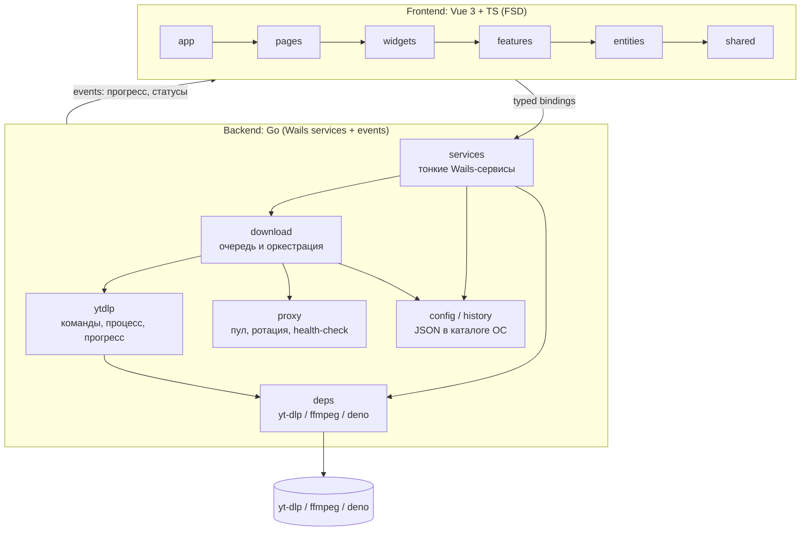
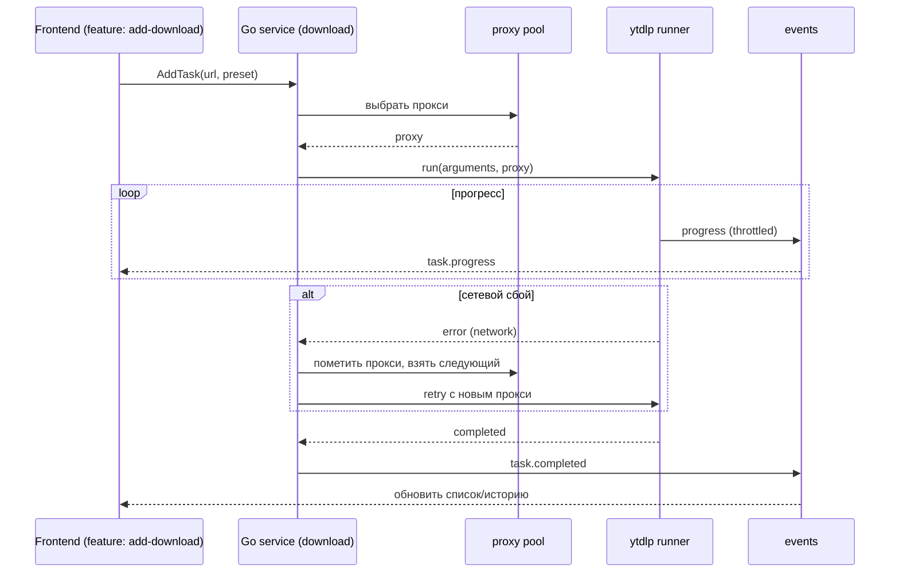

# 00. Обзор

> **Аудитория:** пользователь (рамки и возможности) и разработчик (границы модулей, поток данных).
> Источник правды — эта документация (RU); правила агента — [`../AGENTS.md`](../AGENTS.md).

## Видение

Дать пользователю простой десктопный интерфейс над `yt-dlp`, который:

- не требует командной строки и ручного управления зависимостями;
- запоминает «пресеты» загрузки (формат, папка, субтитры, метаданные и т.п.);
- умеет обходить блокировки и лимиты через **пул прокси** с автопереключением;
- кросс-платформенен и лёгок (нативный webview вместо Electron).

## Рамки (scope)

**В рамках проекта:**

- управление зависимостями: `yt-dlp`, `ffmpeg`/`ffprobe`, JS-рантайм `deno`;
- одиночные загрузки и очередь;
- пресеты настроек загрузки;
- пул прокси: ручное добавление, импорт списком, ротация, health-check, автопереключение;
- выбор и запоминание папки загрузки;
- история загрузок.

**Вне рамок (на старте):**

- встроенный плеер/конвертер медиа;
- облачная синхронизация настроек;
- плагины `yt-dlp`;
- мобильные платформы.

## Структура приложения

## Поток данных: одна загрузка

## Принципы

1. **Тонкие сервисы, толстые домены.** Wails-сервисы — только адаптеры (валидация входa → вызов
   домена → возврат DTO). Вся логика — в пакетах домена.
2. **Наблюдаемость через события.** Долгие операции (загрузка, установка зависимостей)
   стримят прогресс событиями, throttled, чтобы не перегружать webview.
3. **Типы через границу.** Фронтенд общается с Go через сгенерированные типизированные биндинги;
   «сырые» вызовы из компонентов запрещены — только через `shared/api`.
4. **Без утечек.** Любая подписка на события отписывается на `onScopeDispose`.
5. **Зависимости управляются приложением**, а не возлагаются на пользователя.

## Глоссарий

| Термин | Значение |
|--------|----------|
| Задача (task) | Одна загрузка: URL + пресет + состояние + прогресс |
| Пресет (preset) | Именованный набор настроек `yt-dlp` (формат, папка, субтитры…) |
| Пул прокси | Набор прокси-серверов с политикой ротации и health-check |
| Зависимость (dep) | Внешний бинарник: `yt-dlp`, `ffmpeg`, `ffprobe`, `deno` |
| Baseline | Минимально необходимая версия зависимости, **скачиваемая приложением по требованию** (в инсталлятор не входит) |
| Health-check | Проверка работоспособности прокси перед/во время использования |
| Cooldown | Время, на которое сбойный прокси исключается из ротации |
