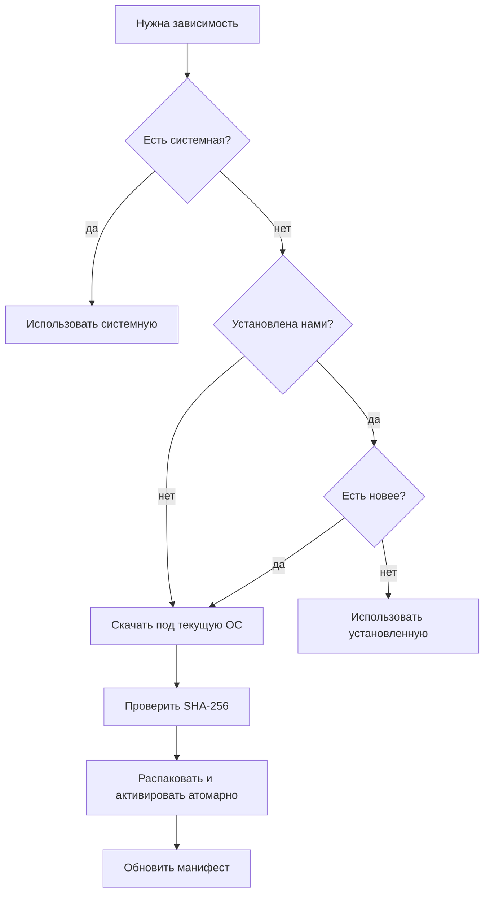

# 04. Управление зависимостями

Приложение само обеспечивает наличие и актуальность внешних бинарников. **Инсталлятор ничего не
встраивает** и остаётся минимальным: сначала ищем зависимость в системе (PATH и типовые места),
скачиваем только при необходимости — по требованию или по явной кнопке пользователя. Единый интерфейс:

```go
// deps.Manager
type Dependency interface {
    Name() string                                  // "yt-dlp" | "ffmpeg" | "deno"
    Detect(ctx context.Context) (Version, bool)    // найти (системный или установленный нами)
    Latest(ctx context.Context) (Release, error)   // узнать последнюю доступную
    Install(ctx context.Context, r Release, onProgress ProgressFunc) error
    Update(ctx context.Context, onProgress ProgressFunc) error
    Path() (string, error)                         // путь к исполняемому файлу
}
```

Общие правила:

- Все файлы зависимостей — в `app-data/deps/<name>/<version>/`.
- **Манифест** `app-data/deps/manifest.json` хранит установленные версии, источник и хэши.
- Установка **атомарна**: скачать в temp → проверить контрольную сумму → распаковать →
  `rename` в целевой каталог → обновить манифест. Прерывание не должно оставлять «половину».
- На Linux/macOS выставляем бит исполнения (`chmod +x`).
- Проверка целостности: **SHA-256** из официальных `*.sha256sum` / `SHA2-256SUMS`.

- Проверка обновлений работает и для **системных** копий: сравниваем установленную версию
  с последним релизом (с нормализацией версий) и только показываем «доступно обновление» —
  системную копию приложение не трогает.

## Общий поток установки/обновления



## Политики использования

Настройка **«источник зависимости»** на каждую зависимость (реализовано):

- `auto` (по умолчанию): управляемая, если установлена, иначе системная;
- `system`: использовать только системную (не скачивать);
- `managed`: использовать только управляемую (системную игнорировать); выбор в UI дополнительно
  принудительно скачивает управляемую копию, если её ещё нет.

---

## yt-dlp

- **Источник:** GitHub Releases `yt-dlp/yt-dlp`.
- **Артефакты (standalone, с авто-обновлением `-U`):**

  | ОС | Файл | Размер |
  |----|------|--------|
  | Windows x64 | `yt-dlp.exe` | ~18 МБ |
  | Linux x86_64 | `yt-dlp_linux` | ~40 МБ |
  | Linux arm64 | `yt-dlp_linux_aarch64` | ~40 МБ |
  | macOS (universal) | `yt-dlp_macos` | ~37 МБ |

  Варианты `.zip` — **без авто-обновления**, не используем.
- **Каналы:** `stable` (по умолчанию), `nightly` (**рекомендуется проектом** для обычных
  пользователей), `master`. Настройка в UI.
- **Проверка:** `SHA2-256SUMS` (файл с суммы, затем сверяем наш артефакт).
- **Обновление:** свой загрузчик (query GitHub Releases API по каналу → сравнить версию →
  скачать/проверить/заменить), с fallback на `yt-dlp --update-to <channel>` при желании.
- **Лицензия:** standalone-бинарники содержат GPLv3+ код. Скачивание из upstream во время
  работы (не встраивание в дистрибутив) проще с точки зрения соблюдения GPL.

## JS-рантайм: deno (для `yt-dlp-ejs`)

- **Зачем:** для полноценного YouTube `yt-dlp` требует `yt-dlp-ejs` + внешний JS-движок.
  **По умолчанию включён только `deno`**; без него клиент `web` отключается и часть видео
  не извлекается. Официальные `yt-dlp`-бинарники уже содержат `yt-dlp-ejs`, но **движок нужен отдельно**.
- **Источник:** GitHub Releases `denoland/deno` (`v2.9.7`), архивы:

  | ОС / арх | Файл |
  |----------|------|
  | Linux x86_64 | `deno-x86_64-unknown-linux-gnu.zip` |
  | Linux arm64 | `deno-aarch64-unknown-linux-gnu.zip` |
  | macOS x86_64 | `deno-x86_64-apple-darwin.zip` |
  | macOS arm64 | `deno-aarch64-apple-darwin.zip` |
  | Windows x64 | `deno-x86_64-pc-windows-msvc.zip` |
  | Windows arm64 | `deno-aarch64-pc-windows-msvc.zip` |

  У каждого — `*.sha256sum`. Размер ~38–42 МБ.
- **Интеграция:** передаём в `yt-dlp` `--js-runtimes deno:<путь>`. Если системный `node` найден
  и пользователь так выбрал — можно `--no-js-runtimes` + `--js-runtimes node:<путь>`
  (приоритет: `deno` > `node` > `quickjs` > `bun`).
- **Политика по умолчанию:** использовать системный рантайм, если есть; иначе скачать `deno`.
  Плюс явная настройка «скачать принудительно» (то же применимо к другим зависимостям).

## ffmpeg / ffprobe

- **Зачем:** склейка video+audio, извлечение аудио, пост-обработка. Нужны **лениво** —
  только когда задача требует merge/post-processing.
- **Источники:** по умолчанию — лёгкие статические сборки `eugeneware/ffmpeg-static`
  (ffmpeg 6.1.1; под капотом johnvansickle (Linux), gyan (Windows x64), evermeet/osxexperts (macOS)).
  Для **Windows ARM64** (где в `ffmpeg-static` сборок нет) — `yt-dlp/FFmpeg-Builds`.

  | ОС / арх | Источник | Формат |
  |----------|----------|--------|
  | Windows x64 | `ffmpeg-static` | `ffmpeg-win32-x64.gz`, `ffprobe-win32-x64.gz` |
  | Windows arm64 | `yt-dlp/FFmpeg-Builds` | `ffmpeg-master-latest-winarm64-gpl.zip` (ffmpeg.exe + ffprobe.exe) |
  | Linux x64/arm64/arm/ia32 | `ffmpeg-static` | `ffmpeg-<plat>.gz`, `ffprobe-<plat>.gz` |
  | macOS x64/arm64 | `ffmpeg-static` | `ffmpeg-darwin-<arch>.gz`, `ffprobe-darwin-<arch>.gz` |

  ffmpeg и ffprobe кладём **вместе** в один каталог (ffprobe нужен `yt-dlp` для ряда постпроцессов).
- **Проверка:** у `ffmpeg-static` нет файлов сумм → SHA-256 берём из `digest` метаданных
  GitHub-релиза; у `FFmpeg-Builds` — из `checksums.sha256`.
- **Версия/обновления:** у `FFmpeg-Builds` тег роллинг (`latest`), поэтому «доступно обновление»
  для ffmpeg не вычисляем; версию показываем из `ffmpeg -version`, обновление — вручную.
- **Интеграция:** передаём `--ffmpeg-location <каталог>`. Если предпочитаем системный —
  не передаём флаг (yt-dlp найдёт в PATH).
- **Лицензия:** GPL-сборки. По умолчанию — **скачивать во время работы**, не встраивая в инсталлятор.

## Сводная таблица

| Зависимость | Системная? | Источник download | Проверка | Когда качаем |
|-------------|-----------|-------------------|----------|--------------|
| `yt-dlp` | да (PATH) | GitHub `yt-dlp/yt-dlp` | SHA2-256SUMS | первый запуск / по кнопке |
| `deno` | `node`/`deno` в PATH | GitHub `denoland/deno` | `.sha256sum` | если нет JS-рантайма |
| `ffmpeg`,`ffprobe` | да (PATH) | `ffmpeg-static` (Win arm64 — FFmpeg-Builds) | digest / checksums.sha256 | **лениво**, при merge/postprocess |

## Прочие зависимости со схожим поведением

Если позже добавятся другие бинарники, работающие по той же схеме (поиск в PATH → скачивание →
проверка → атомарная установка → обновление), они реализуют тот же интерфейс `Dependency`,
получая установку/обновление «бесплатно».
